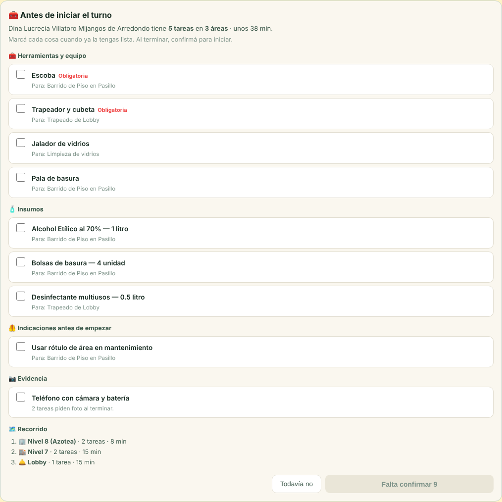
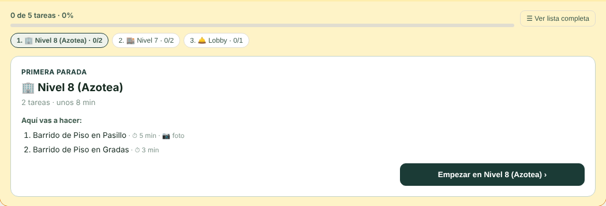
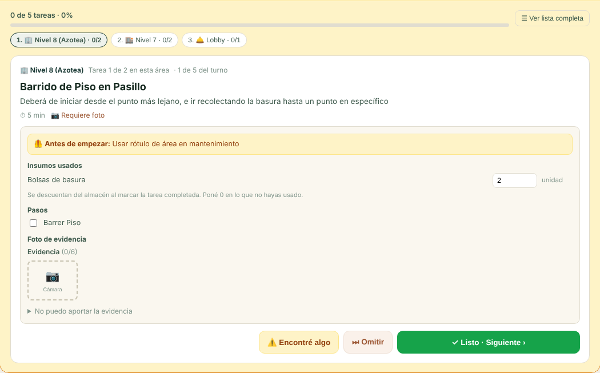
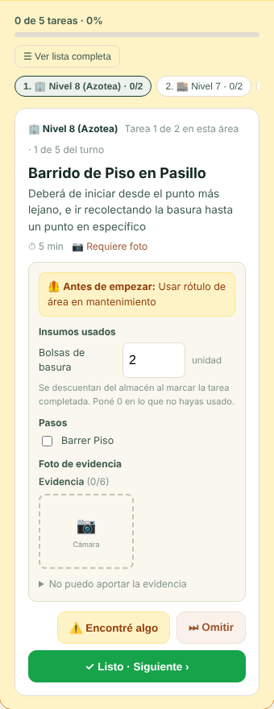
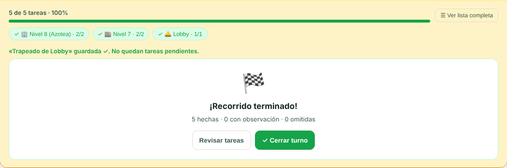

# Ejecución guiada de un turno

En **Condominios → Recursos Humanos → Tareas por turno**, y en la **Ruta del día** de Limpieza (que usa el mismo
tablero), un turno ya no muestra todas sus tareas de golpe para ejecutarlo. Hay tres momentos:

1. **Antes de iniciar.** Lo que hay que tener a mano, para confirmarlo una cosa por una.
2. **En curso.** Una tarjeta por vez, área por área. Un solo botón guarda la tarea y pasa a la siguiente.
3. **Al terminar.** Un resumen y el cierre del turno.

Sólo cambia la pantalla: no hay migración. Guardar sigue pasando por lo mismo de siempre: la RPC de cierre con consumo de
insumos y el trigger de evidencia.

## Antes de iniciar

**▶ Iniciar** ya no arranca el turno de un clic. Primero abre «Antes de iniciar el turno», armado con las tareas pendientes:

| Sección | De dónde sale |
|---|---|
| 🧰 Herramientas y equipo | Las de la plantilla de cada tarea (`plantilla_tarea_herramientas`). Va la mayor cantidad que pida **una** tarea (la escoba se reusa), y es *Obligatoria* si alguna lo exige. Lo obligatorio va primero. |
| 🧴 Insumos | El plan congelado de cada tarea (`tarea_bloque_suministros`) que todavía no se descontó ni se declaró no usado. Aquí **sí** se suma entre tareas. |
| 🦺 Indicaciones antes de empezar | Las instrucciones de seguridad de las tareas, sin repetir. |
| 📷 Evidencia | «Teléfono con cámara y batería» si alguna tarea pide foto. |
| 🗺️ Recorrido | Las áreas en orden, con cuántas tareas y cuánto tiempo. Es información: no se confirma. |

Cada cosa tiene su casilla. El botón dice «Falta confirmar N» hasta que estén todas, y entonces **✓ Tengo todo · Iniciar
turno** inicia el turno. «Todavía no» vuelve sin iniciar. Si no se pudieron leer las herramientas, se avisa con el error y
el resto de la lista igual se muestra. Si la base no deja iniciar el turno, también se avisa: antes ese error se ignoraba
y el botón parecía no hacer nada.

## En curso: una tarjeta por vez

- **Paradas.** Las tareas consecutivas de la misma área son una parada. Si el turno vuelve a un área más tarde, es otra
  parada. Arriba se ven el avance del turno y las paradas, cada una con «hechas/total», y se puede saltar a cualquiera.
- **Al llegar a un área**, una tarjeta dice qué se va a hacer en ella, con el tiempo de cada tarea y cuáles piden foto.
  **Empezar en …** pasa a la primera tarea.
- **La tarjeta de la tarea** trae, por este orden, las indicaciones, los insumos (con la cantidad editable), los pasos,
  la foto, el comentario y «No puedo aportar la evidencia». Es el mismo panel que la lista muestra al tocar 📋: hay una
  sola copia.
- **✓ Listo · Siguiente** guarda la tarea con el mismo cierre de la lista y avanza a la próxima pendiente. Si falta
  evidencia, avisa qué falta y **no avanza**. Un comentario recién escrito se guarda antes del cierre, porque el trigger
  lee la fila y no la pantalla.
- **⚠️ Encontré algo** registra la novedad (texto, prioridad, mantenimiento) y avanza.
- **⏭ Omitir** pregunta antes. Aquí es un botón grande junto a «Listo», y omitir queda registrado como no hecho.
- **‹ Anterior** deja ver lo ya resuelto, sin botones para ejecutarlo.
- **☰ Ver lista completa** vuelve a la lista de siempre, donde quien arma el turno sigue pudiendo cargar o agregar
  tareas. **▶ Volver al paso a paso** regresa.

| Llegada a un área | Tarea |
|---|---|
|  |  |

Al pasar de tarjeta, el foco va al título de la nueva tarjeta y un aviso dice qué se guardó y qué sigue. La entrada de la
tarjeta se anima, salvo que el sistema pida menos movimiento.

## Al terminar

Cuando no queda nada pendiente, el resumen cuenta las tareas hechas, con observación y omitidas, y ofrece **✓ Cerrar
turno**. Si quedan pendientes, ofrece «Ir a lo pendiente».

## Lo que se corrigió de paso

- **Dos pasos marcados seguidos ya no se pisan.** El segundo partía de la fila vieja, porque la recarga todavía no había
  vuelto. Ahora los pasos y las fotos guardados se recuerdan en la pantalla hasta que la recarga trae lo mismo.
- **El comentario y el motivo son de cada tarea.** Al pasar de una tarea a otra, lo escrito en una no aparece en la
  siguiente.
- **Iniciar y cerrar el turno ya no ignoran el error de la base.** Además, el turno se ve iniciado o cerrado sin esperar la
  recarga. Antes seguía el botón anterior, y un segundo clic volvía a escribir `iniciado_en` o `cerrado_en`.
- **El puntaje de cierre cuenta la última tarea**, aunque la recarga todavía no la haya traído como hecha.

## Pruebas

| Qué | Dónde |
|---|---|
| Reglas puras: paradas, siguiente pendiente, preparación (herramientas por la mayor cantidad, insumos sumados, indicaciones sin repetir, cámara) | `src/domain/condominios/__tests__/ejecucionGuiada.test.ts` |
| Pantalla: preparación antes de iniciar, avance por paradas, evidencia, comentario antes del cierre, pasos seguidos, omitir, novedad, resumen y cierre | `src/components/condominios/tabs/__tests__/TareasPersonalTab.guiada.test.tsx` |
| La lista de siempre (evidencia, insumos, novedades) | `TareasPersonalTab.{evidencia,insumos,novedades}.test.tsx`, que ahora pasan a «Ver lista completa» |
