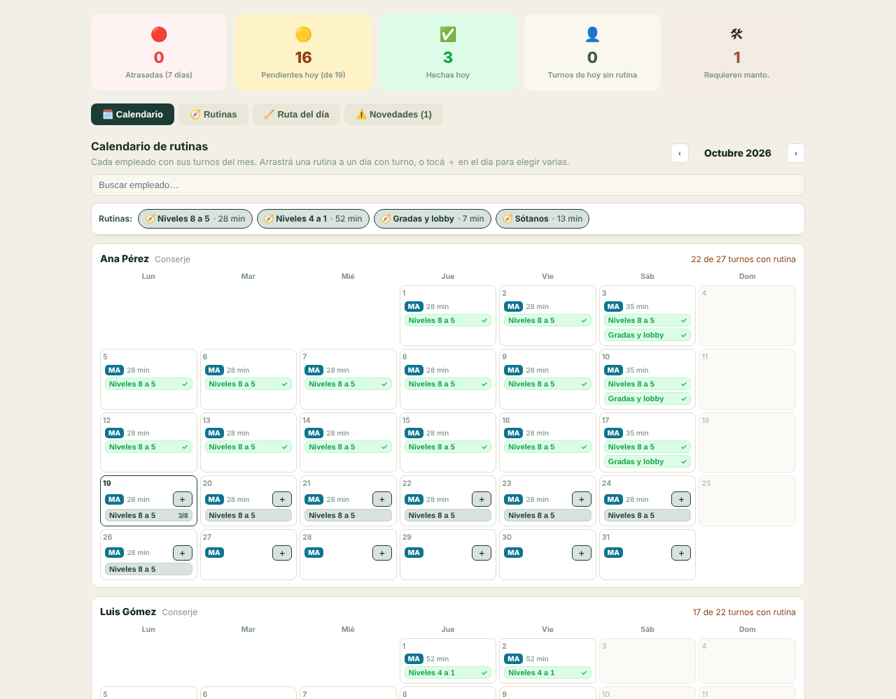
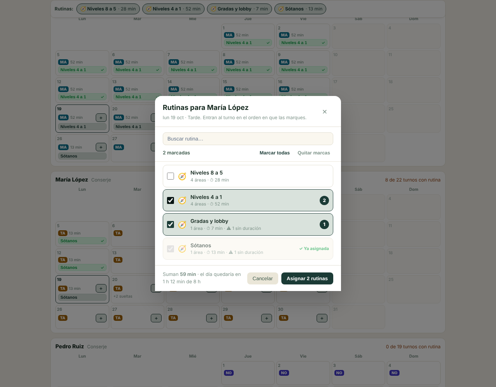
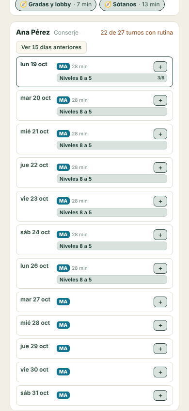
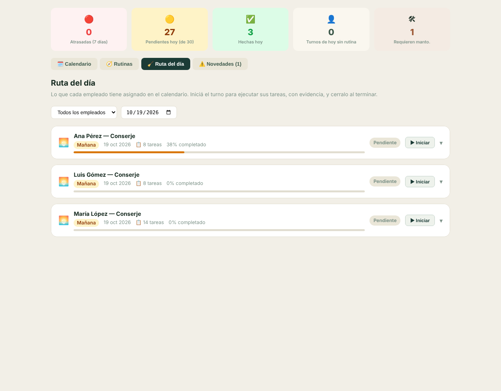

# Limpieza · calendario de rutinas por empleado y día

Migración `20261103000000_limpieza_calendario_rutinas`. En **Condominios → Recursos Humanos → Limpieza** el tab queda en
cuatro vistas:

| Vista | Qué es |
|---|---|
| **🗓️ Calendario** | Cada empleado activo con sus turnos del mes. Sobre cada día de turno se le asignan las rutinas que tiene que hacer ese día. |
| **🧭 Rutinas** | Los recorridos ([RUTINAS_RECORRIDO.md](RUTINAS_RECORRIDO.md)): áreas en orden y sus actividades. Es la definición de lo que se asigna. |
| **🧹 Ruta del día** | Lo asignado para un día, para ejecutarlo con evidencia y cierre. |
| **⚠️ Novedades** | Lo que se encontró al ejecutar las rutinas y necesita mantenimiento. |

Salieron **Áreas** (programar cada área con frecuencia y responsable: el calendario la reemplaza), **Áreas del catálogo**
y **Actividades** (consultas de catálogos que se administran en el tab Áreas y en Plantillas). En **Rutinas** salió
**Generar tareas**, que le daba cada rutina a todos los turnos de su jornada sin poder elegir a quién.



## Cómo se asigna

- **Arrastrando:** la rutina se arrastra desde la barra de rutinas, que queda fija arriba mientras se recorre el mes, y
  se suelta sobre el día.
- **Con ＋:** el ＋ del día abre una ventana para marcar varias rutinas. Entran en el orden en que se marcan, y el pie
  dice cuánto quedaría el día contra las horas del turno.
- **Mover:** se arrastra una rutina ya puesta a otro día o a otra persona. Primero se asigna allá y después se quita de
  acá: si lo segundo fallara, queda en los dos lugares y se ve.
- **Ver o quitar:** al tocar una rutina se ve cómo va (tareas hechas y pendientes). Se puede quitar mientras **ninguna**
  de sus tareas se haya trabajado.

Cada gesto se guarda al instante; no hay borrador. **Asignar es crear las tareas** del recorrido en el turno de ese día,
con el área de cada parada y en el orden del recorrido. No hay un paso de «generar» después.

En cada día se ve:
- el código y el color de la jornada;
- lo asignado contra lo que dura el turno, con ⚠ si se pasa;
- las tareas sueltas que el turno tenga de «Tareas por turno».

| ＋ varias rutinas | Teléfono |
|---|---|
|  |  |

En pantallas angostas el mes se lee como lista de días, desde hoy. Los días anteriores se despliegan a pedido.

### Qué días aceptan rutinas

- **Solo días con turno.** Los turnos los crea **Asignación turnos** (generar el mes o el día a mano). Un día sin turno se
  ve apagado.
- **De hoy en adelante y con el turno abierto.** Hoy es el de la zona horaria de la empresa. Lo pasado y lo cerrado se
  ven, pero no se tocan.
- **El turno queda ocupado.** Un turno con tareas ya no se puede quitar ni re-planificar desde «Asignación turnos»
  (regla de `turnos_asegurar_bloque_libre`). Quitar sus rutinas mientras nada esté trabajado lo libera otra vez.

## Ruta del día, novedades e indicadores



**Ruta del día** muestra los turnos del día que tienen alguna rutina. Es el mismo tablero de «Tareas por turno», en modo
ruta:
- Se puede iniciar el turno, ejecutar cada tarea (evidencia, checklist, insumos, novedad) y cerrarlo, con los mismos
  controles de la base.
- No se pueden crear ni borrar turnos ni tareas sueltas: el trabajo lo asigna el calendario.
- Del turno se traen **todas** sus tareas, no sólo las de rutina, porque el cierre calcula el puntaje sobre lo que ve.

Los **indicadores** y las **novedades** salen de esas tareas:

| Indicador | Qué cuenta |
|---|---|
| Atrasadas (7 días) | Tareas de rutina que quedaron pendientes en la semana anterior |
| Pendientes hoy (de N) | Tareas de rutina de hoy sin hacer, sobre el total de hoy |
| Hechas hoy | Tareas de rutina de hoy cerradas (completas o con observación) |
| Turnos de hoy sin rutina | Turnos de hoy sin nada asignado, de quienes hacen rutinas (tuvieron alguna en los últimos 30 días); así no cuenta los turnos de seguridad o mantenimiento |
| Requieren manto. | Novedades de los últimos 30 días marcadas para mantenimiento |

## Base de datos

| Función | Qué hace | Quién |
|---|---|---|
| `limpieza_calendario(proyecto, desde, hasta)` | Turnos del rango (≤ 92 días) con nombre, cargo y estado de la persona, su jornada (nombre, código, color, horario) y, por turno, las rutinas asignadas (`tareas`, `pendientes`, `hechas`, `trabajadas`) y cuántas tareas sueltas tiene. | Ver el tab de Limpieza + empresa + acceso al proyecto |
| `limpieza_asignar_rutinas(turno, rutinas[])` | Crea las tareas del recorrido de cada rutina en ese turno, detrás de lo que ya tenía y en el orden pedido. Lo que ya está (misma actividad en la misma área, aunque esté anulado) se omite. Una rutina inactiva, de otro condominio o sin actividades activas se rechaza. | **Editar** Limpieza (`condominios_puede_actuar`) + empresa + proyecto; turno abierto, de hoy en adelante |
| `limpieza_quitar_rutina(turno, rutina)` | Borra las tareas de esa rutina en ese turno si **ninguna** se trabajó. Si alguna sí, `55000` y no borra nada. | Lo mismo |

- **Trabajada** tiene una sola definición, `limpieza_tarea_trabajada`, que comparten la lectura (para ofrecer o no
  quitar) y el borrado (para negarlo). Una tarea cuenta como trabajada si cumple cualquiera de esto:
  - su estado no es `pendiente`, o está cerrada o anulada;
  - tiene evidencia, fotos, checklist marcado o novedad;
  - tiene una revisión;
  - tiene un insumo consumido o declarado no usado.
- **No hay tabla nueva.** La asignación es la tarea: `tareas_bloque.rutina_id` ya dice de qué rutina salió cada una.
- **Lo mínimo del personal.** La lectura es SECURITY DEFINER porque quien administra la limpieza no lee
  `personal_condominio` ni `plantillas_horario` por RLS. Proyecta sólo nombre, cargo y estado de la persona, y nada del
  expediente (salario, DPI, cuenta…). Sigue el patrón de `rutas_operadores_asignables`.
- **Sin cambios:**
  - `materializar_rutinas_turno` sigue existiendo, pero ya ninguna pantalla la llama.
  - `programacion_limpieza` y `ejecuciones_limpieza` quedan como historia; el panel todavía las carga.

## Pruebas

| Qué | Dónde |
|---|---|
| Suite SQL ejecutable: cadena completa, huella del auditor (cambian exactamente 10 grupos), 52 invariantes, 14 mutantes | `supabase/tests/limpieza_calendario/` (`run.sh`, `fixture.sql`, `assert.sql`) |
| Guardas estáticas: proyección mínima del personal, permiso de acción, REVOKE, ninguna pantalla llama a materializar | `src/__tests__/limpiezaCalendarioMigracion.test.ts` |
| Dominio puro (qué se programa, qué se quita, carga del turno, indicadores) | `src/domain/condominios/calendarioLimpieza.ts` (+ `__tests__/calendarioLimpieza.test.ts`) |
| Vistas | `__tests__/VistaCalendario.test.tsx`, `__tests__/VistaRutaDia.test.tsx`, `tabs/__tests__/ProgramacionLimpiezaTab.test.tsx` |

## Reversión

Quitar la migración no borra nada: las tareas ya asignadas son `tareas_bloque` normales.

```sql
DROP FUNCTION IF EXISTS public.limpieza_quitar_rutina(uuid, uuid);
DROP FUNCTION IF EXISTS public.limpieza_asignar_rutinas(uuid, uuid[]);
DROP FUNCTION IF EXISTS public.limpieza_calendario(uuid, date, date);
DROP FUNCTION IF EXISTS public.limpieza_asegurar_turno_programable(public.bloques_turno);
DROP FUNCTION IF EXISTS public.limpieza_tarea_trabajada(public.tareas_bloque);
```

## Pendiente

- Retirar las cargas de `programacion_limpieza` y `ejecuciones_limpieza` del panel. Ya no tienen pantalla, pero
  retirarlas toca el batch posicional de `sectionData.ts` y varias guardas; va en un cambio aparte.
- Después del despliegue, refrescar la huella de producción: cambian los 10 grupos de las cinco funciones nuevas.
