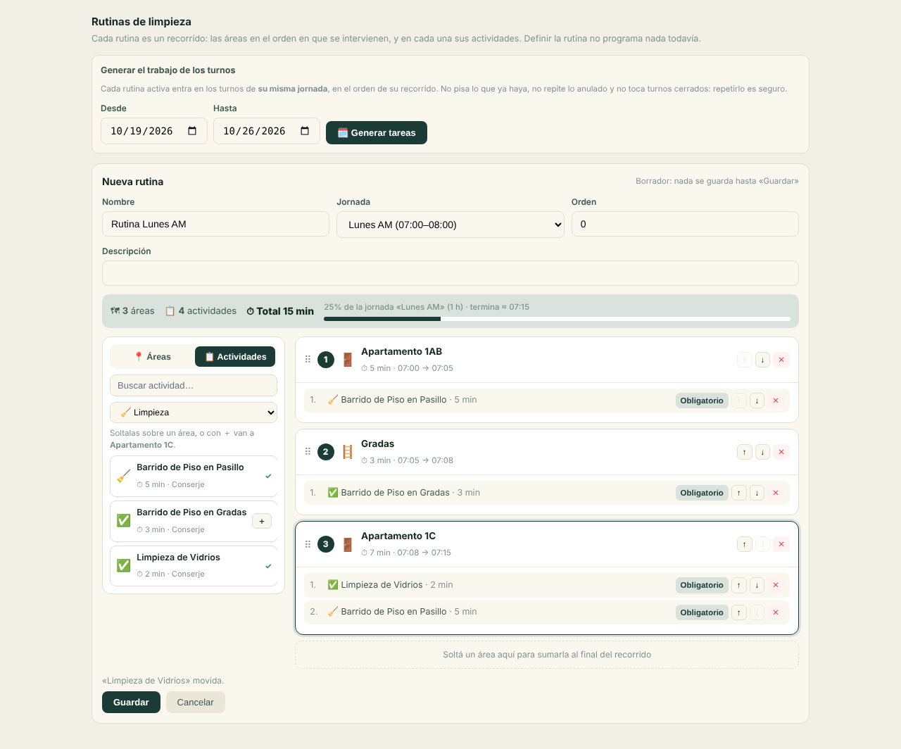
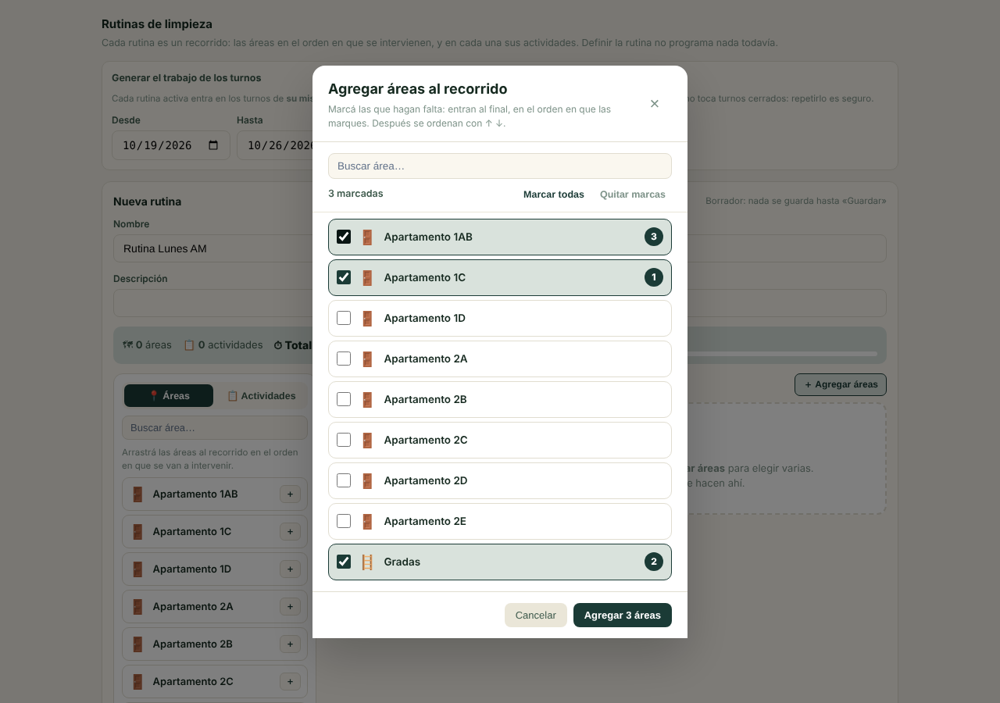
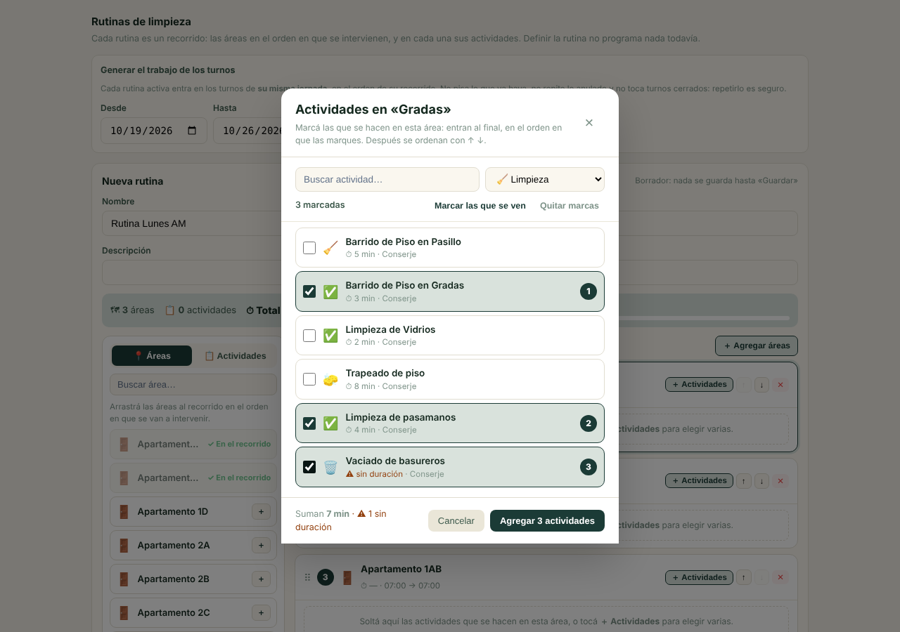
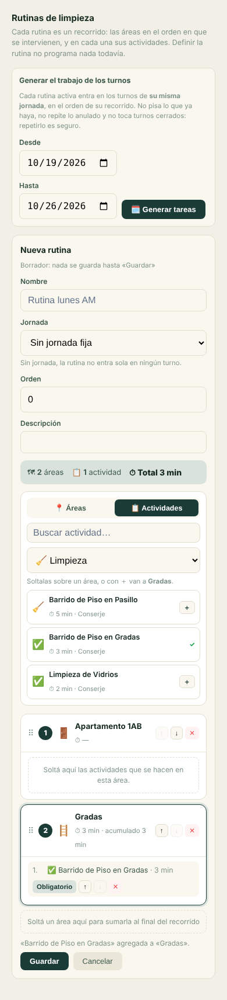
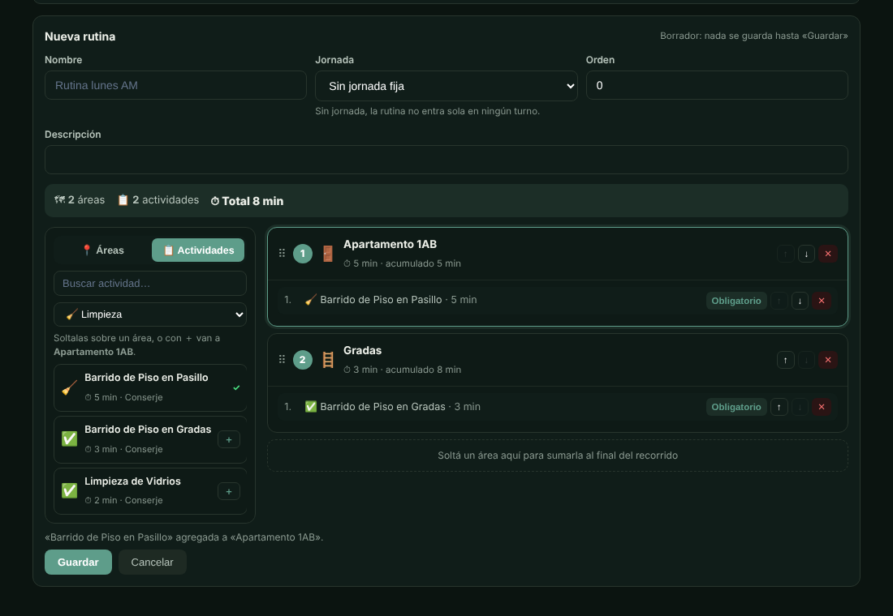

# Limpieza · Rutinas como recorrido por áreas (arrastrar y soltar)

Migración `20261102000000_rutinas_recorrido_por_areas`. En **Condominios → Recursos Humanos → Limpieza → Rutinas**, una
rutina deja de ser una lista plana de actividades con un área opcional en la cabecera y pasa a ser un **recorrido**:

1. primero se eligen las **áreas**, en el orden en que se van a intervenir («Apartamento 1AB → Apartamento 1C →
   Gradas»), arrastrándolas desde la paleta y reordenándolas arrastrando su cabecera;
2. después a cada área se le **sueltan encima las actividades** del catálogo que se hacen ahí, también en orden. La
   misma actividad puede estar en varias áreas (se barre en cada pasillo);
3. el **tiempo se va acumulando**: cada área suma las duraciones de sus actividades y arranca donde terminó la
   anterior. Con jornada, se lee como hora estimada («07:00 → 07:07») y el total se compara con lo que dura la jornada
   (aviso si no cabe). Las actividades sin duración se cuentan aparte.

Quien recibe la rutina en su turno la hace en ese orden: las tareas se crean con el área de su parada y en el orden
rutina → área → actividad. **A quién y qué día** se decide en el **Calendario** de Limpieza
([LIMPIEZA_CALENDARIO.md](LIMPIEZA_CALENDARIO.md), 20261103000000), que reemplazó a «Generar tareas» por jornada.

Sin arrastre (pantallas táctiles, teclado) cada gesto tiene su botón: **＋** en la paleta (las actividades van al área
seleccionada, la de borde resaltado), **↑ ↓** para reordenar —en el borde de un área la actividad cruza a la vecina— y
**✕** para quitar. Todo es **borrador hasta «Guardar»**: cabecera y recorrido se guardan juntos.

**Varias de una vez.** **＋ Agregar áreas** (arriba del recorrido) abre una ventana para marcar muchas áreas juntas, y
**＋ Actividades** (en la cabecera de cada área) hace lo mismo con el catálogo de actividades, con búsqueda, filtro de
servicio y lo que suman las marcadas. Lo marcado entra **al final, en el orden en que se marcó** (cada marca muestra su
número), y después se acomoda con ↑ ↓ o arrastrando. Lo que ya está se ve marcado y apagado. Las marcas sobreviven a la
búsqueda, y «Marcar todas» / «Marcar las que se ven» marca de una vez lo listado.

| ＋ Agregar áreas | ＋ Actividades de un área |
|---|---|
|  |  |

| Móvil | Modo oscuro |
|---|---|
|  |  |

## Archivos

| Qué | Dónde |
|---|---|
| Migración (tabla de paradas, paso → parada, unicidad por área, RPC de guardado, materialización) | `supabase/migrations/20261102000000_rutinas_recorrido_por_areas.sql` |
| Suite SQL (cadena completa, huella del auditor, forma desconocida de producción, purga, 9 mutantes) | `supabase/tests/rutinas_recorrido/` (`run.sh`, `fixture.sql`, `assert.sql`, `assert_purga.sql`) |
| Guardas estáticas | `src/__tests__/rutinasRecorridoMigracion.test.ts`; `materializarRutinasRls.test.ts` e `insertSoloPendiente.test.ts` ahora vigilan la versión viva de la RPC |
| Dominio puro (cada gesto del editor y el tiempo acumulado) | `src/domain/condominios/rutinasRecorrido.ts` (+ `__tests__/rutinasRecorrido.test.ts`) |
| Datos | `fetchRutinasLimpieza` (trae `paradas`) en `tabQueries.ts`; `guardarRecorridoRutina` en `tabMutations.ts` |
| Pantalla | `src/components/condominios/tabs/limpieza/EditorRutina.tsx`, `SelectorVarios.tsx` (ventana de «agregar varias»), `VistaRutinas.tsx` (+ `__tests__/VistaRutinas.test.tsx`) |
| Tipos | `RutinaArea`, `ResultadoGuardarRecorrido`, `RutinaActividad.rutina_area_id` en `src/types/condominios/operaciones.ts`; `src/types/database.types.ts` |
| Recuperación | `scripts/reversion-rutinas-recorrido.sql` |
| CI | paso «Rutinas como recorrido por áreas…» en `.github/workflows/coverage.yml` |

## Modelo

- **`rutina_areas`** — las paradas: `rutina_id`, `area_id`, `orden`, `notas`. Una parada por área y rutina
  (`rutina_areas_unica`). FKs **compuestas** `(… , company_id, project_id)` hacia la rutina (CASCADE) y el área
  (RESTRICT); el trigger `rutina_area_coherente` sella el tenant desde la rutina. RLS con el gate
  `condominios.tab.prog_limpieza`, igual que `rutina_actividades`.
- **`rutina_actividades.rutina_area_id`** — de qué parada cuelga el paso, por FK compuesta `(rutina_area_id, rutina_id)`
  hacia el ancla `(id, rutina_id)`: un paso no puede colgar de la parada de otra rutina. Quitar una parada se lleva sus
  pasos. `NULL` = **paso legado** (las rutinas anteriores): se ven como «Actividades sin área», primero, y se
  materializan exactamente como antes (área de la actividad o, si no tiene, la de la rutina). Se pueden arrastrar (o
  bajar con ↓) a un área.
- La unicidad del paso pasa de `(rutina, actividad)` a `(rutina, parada, actividad)` `NULLS NOT DISTINCT`.
- **`tareas_bloque`**: `uq_tareas_bloque_plantilla_area (bloque, plantilla, área) NULLS NOT DISTINCT` reemplaza a
  `(bloque, plantilla)`. «Cargar tareas del cargo» dos veces sigue sin duplicar (misma área); «barrer» en dos
  apartamentos son dos tareas.
- **`guardar_recorrido_rutina(p_rutina_id, p_recorrido jsonb)`** — **SECURITY INVOKER**: recibe la foto completa del
  recorrido y la reconcilia en una transacción por identidad natural (área; área + actividad): conserva lo que sigue
  (con sus notas), crea lo nuevo, borra lo que no viene. Valida la foto entera antes de escribir y bloquea la rutina
  (`FOR UPDATE`) para que dos guardados no se mezclen.
- **`materializar_rutinas_turno`** — misma firma y controles; el área de cada tarea es la de su parada, el orden sigue
  al recorrido, la parada de un área dada de baja no genera trabajo nuevo y «ya existe» compara también el área.
- `rutinas_limpieza.area_id` queda como **legado** (sólo aplica a pasos sin parada); el editor ya no lo ofrece.

## Despliegue: los índices de `tareas_bloque`

`tabla:tareas_bloque/indices` tenía **drift declarado** contra producción desde el 2026-09-01 (#826). Esta migración
**tiene que** tocar ese grupo, porque es la única forma de que la misma actividad exista en dos áreas de un turno. Con el
drift declarado, el auditor de tres vías la marcaba **CAMBIO AMBIGUO**.

Se midió producción (`pg_indexes`, 2026-10-19). La unicidad `uq_tareas_bloque_plantilla` existe allá con el mismo nombre
y la misma forma que en el repositorio. Las diferencias eran otras tres:

- el nombre del índice `(bloque_id, orden)`;
- la definición del índice de `completado_por`;
- un índice de `plantilla_id` que producción no tiene.

ventas-png/control-consumo-agua#953 (`20261101000000`) hace converger el repositorio a esa forma: es no-op en producción y
retira la entrada de `drift-conocido.json`. **Se fusiona antes que este PR**; con eso, este cambio pasa a ser CAMBIO
PLANIFICADO.

Esta migración, además:

- **Retira la unicidad vieja por sus columnas** `(bloque_id, plantilla_id)`, sea índice o constraint y se llame como se
  llame, con un aviso `RUTINAS_RECORRIDO: retirada la unicidad …` (NOTICE). La API con la que despliega
  `apply-migrations-prod.yml` no devuelve los NOTICE, así que el log del workflow no lo muestra: el resultado se
  comprueba en `pg_indexes`.
- **Aborta en un pre-vuelo** toda la migración, sin tocar nada, si hubiera filas repetidas en (bloque, actividad, área).
- **Devuelve el índice líder de la FK `plantilla_id`** (`idx_tareas_bloque_plantilla_id`, política de `20260606170000`),
  que producción nunca tuvo y que la unicidad nueva no cubre.

**`20261101000000` y `20261102000000` desplegadas el 2026-10-19**, en ese orden: PR #953 fusionada como `553039de`, run
39302743669 de «Apply Migrations to Production» (evento `push`, `success` a las 19:01 UTC); PR #951 fusionada como `c0934969`,
run 39306560861 (`success` a las 19:02 UTC). Comprobación posterior de solo lectura en producción (20:12 UTC): 890
migraciones, máx. `20261102000000`; `rutina_areas` y `guardar_recorrido_rutina(uuid, jsonb)` existen, y `tareas_bloque` tiene
7 índices: `uq_tareas_bloque_plantilla_area` e `idx_tareas_bloque_plantilla_id` en lugar de `uq_tareas_bloque_plantilla`.
Huella de producción recapturada: 11 grupos nuevos y 5 cambiados (3731 → 3742), exactamente los 16 que el auditor anunció
como cambio planificado, con valores idénticos a la reconstrucción de `main`; los 3726 grupos restantes son idénticos a la
captura anterior y el sha256 completo coincide con el medido en producción; `drift-conocido.json` no cambia.

## Recuperación

`scripts/reversion-rutinas-recorrido.sql`: A) diagnóstico de solo lectura (cuántos recorridos hay y qué filas chocarían
con los UNIQUE originales); B) reversa completa, que **aborta** si ya hay datos que sólo el modelo nuevo admite en vez de
borrarlos.

## Límites conocidos

- El arrastre nativo de HTML no existe en todos los navegadores táctiles; ahí se arma con los botones.
- Una parada por área: el recorrido no pasa dos veces por la misma área (la tarea se identifica por bloque, actividad y
  área, así que una segunda pasada con la misma actividad sería la misma tarea).
- Independiente de este cambio: desde `20261031000300`, la purga de una empresa que tenga actividades en el catálogo se
  traba en `RRHH_CARGO_EN_USO` (reproducido en Postgres local, en la forma de llaves de producción). La suite de purga de
  este cambio mide sólo las paradas por eso; el arreglo va aparte.
